<p align="center">
  
</p>

<h1 align="center">Ocelo<br><sub><sup><sup><sub>Copyright (©) 2026 Erik Pimenta</sub></sup></sup></sub></h1>

<p align="center">
  Explorador visual de 33 protocolos da internet, do HTTP ao Modbus. Cada protocolo é contado passo a passo, com a topologia de rede animada salto a salto, o diagrama de sequência entre as pontas, o fluxo de pacotes no estilo do Wireshark e um inspetor que abre cada quadro byte a byte, com Ethernet, IP, TCP ou UDP e a camada de aplicação montados de verdade, checksums inclusos. São 177 passos e 432 pacotes, em português e inglês, com tema claro e escuro, duas paletas de cores (a do Bento, padrão, e a do Nexo), busca, atalhos de teclado e modo foco. Roda inteiro no navegador, sem servidor e sem dependências em produção.<br>
  Pronto para usar, estudar ou adaptar.
</p>

<p align="center">
  TypeScript · HTML5 · CSS3 · SVG · Vite · Vitest · Playwright · GitHub Actions · GitHub Pages
</p>

<p align="center">
  <a href="https://ravelroot.github.io/Network-Protocol-Packet-Explorer/"><b>Abrir o Ocelo no navegador</b></a>
</p>

---

> **Manual completo:** [`Manual-Ocelo.pdf`](Manual-Ocelo.pdf) explica a instalação, a publicação no GitHub Pages, cada parte da interface (lista de protocolos, camadas OSI, vista de rede, vista de sequência, detalhes do passo, fluxo de pacotes e inspetor byte a byte), a arquitetura do código, o motor que monta os quadros, o formato de dados de um protocolo, como adicionar um protocolo novo, os testes, a segurança, a personalização e a solução de problemas, passo a passo (cópia em [`docs/`](docs/Manual-Ocelo.pdf)).

> **Banco de dados:** [`Banco-de-Dados-Ocelo.pdf`](Banco-de-Dados-Ocelo.pdf) traz a sugestão de arquitetura para quando o catálogo sair dos arquivos TypeScript e passar para um banco: o diagrama de relacionamentos, todas as tabelas com campos, tipos, chaves e restrições, os índices, as decisões (PostgreSQL, textos bilíngues, quadros em JSONB, versões publicadas), os fluxos de dados, a operação e como escalar (cópia em [`docs/`](docs/Banco-de-Dados-Ocelo.pdf)).

<p align="center">
  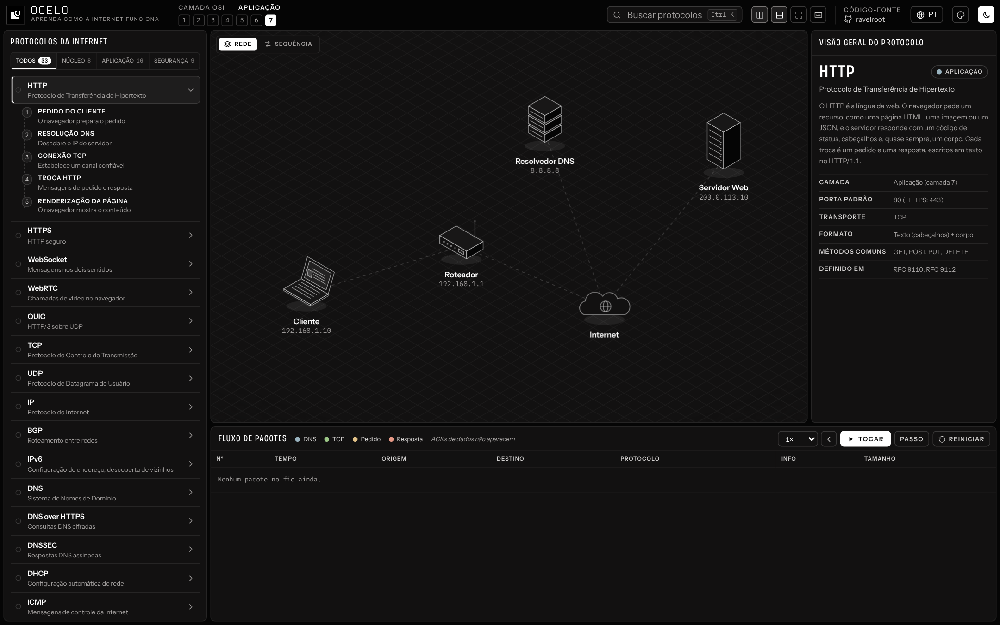
</p>

## O que o Ocelo faz

- **33 protocolos em três categorias:** Núcleo (TCP, UDP, IP, BGP, IPv6, DNS, DHCP e ICMP), Aplicação (HTTP, WebSocket, WebRTC, QUIC, NTP, Wi-Fi, portal cativo, SMTP, POP3, IMAP, FTP, SMB, proxy HTTP, SOCKS5, proxy reverso e Modbus) e Segurança (HTTPS, DNS over HTTPS, DNSSEC, WPA3, RADIUS, SSH, TLS, WireGuard e IPsec). Cada aba mostra o total, e a lista abre os passos do protocolo escolhido com o andamento de cada um.
- **Camadas OSI:** o cabeçalho destaca a camada do protocolo aberto, de 1 a 7, e um clique em qualquer número filtra a lista por aquela camada.
- **Vista de rede:** os aparelhos aparecem em desenho isométrico (notebook, celular, roteador, internet, servidores, ponto de acesso, gateway, CLP e outros) e cada pacote viaja salto a salto, com aceleração suave, parada em cada roteador, rastro, trilho animado na cor do tipo de pacote, ondas de saída e de chegada e queda visível quando o pacote se perde. Quem não participa do passo atual fica esmaecido.
- **Vista de sequência:** as pontas da conversa viram faixas com o próprio ícone, os passos viram faixas horizontais e cada pacote vira uma seta inclinada com o rótulo, o tempo e as notas (como "fora do cache" ou "segmento 1 perdido"). O cabeçalho fica fixo ao rolar.
- **Detalhes do passo:** o painel da direita alterna entre a visão geral do protocolo (descrição, camada, porta, transporte, formato e RFCs) e o passo atual, com a explicação, o cartão do último pacote e os números que importam naquele momento.
- **Fluxo de pacotes:** a tabela no estilo do Wireshark mostra número, tempo, origem, destino, protocolo, informação e tamanho de cada pacote assim que ele entra no fio, com legenda de cores, observações e os pacotes perdidos marcados.
- **Inspetor byte a byte:** um clique em qualquer pacote abre o quadro inteiro, com a barra de camadas proporcional ao tamanho, a árvore de campos com o valor e a explicação de cada um e o dump hexadecimal com ASCII. Passar o mouse num campo acende os bytes dele, e passar num byte acende o campo. Valores que mudam em toda captura levam o selo "ex." e bytes cifrados ou aleatórios aparecem como "··".
- **Quadros de verdade:** o motor monta Ethernet II, 802.11 com LLC/SNAP, ARP, EAPOL, IPv4, IPv6, TCP (com opções no SYN e SACK), UDP, ICMP e ICMPv6 com os checksums corretos, e a consulta DNS do HTTP sai com os mesmos 75 bytes de uma captura real.
- **Reprodução:** tocar e pausar, avançar e voltar um passo, reiniciar e quatro velocidades (0,5×, 1×, 2× e 4×). Um clique num passo da lista leva direto ao fim dele.
- **Busca e atalhos:** `Ctrl` + `K` ou `/` abre a busca por sigla ou nome, nas duas línguas. `Espaço` toca, as setas mudam de passo e de protocolo e `?` mostra todos os atalhos.
- **Idiomas, temas e paletas:** português e inglês em todo o conteúdo, tema claro e escuro e duas paletas de cores, escolhidas pelas amostras no menu de paleta: a do Bento (padrão) e a do Nexo. A escolha fica salva no navegador.
- **Modo foco e painéis:** a lista e o fluxo de pacotes podem ser escondidos e o modo foco deixa só a animação na tela. O layout se reorganiza no tablet e no celular.
- **Endereço por protocolo:** cada protocolo tem o próprio link (por exemplo, `#/dns`), bom para compartilhar ou usar em aula.

<p align="center">
  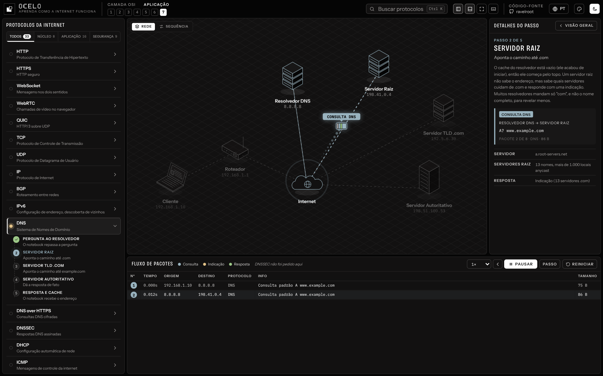
  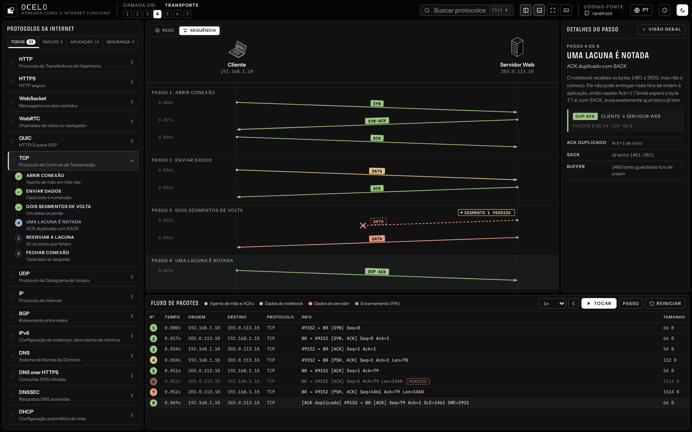
</p>

<p align="center">
  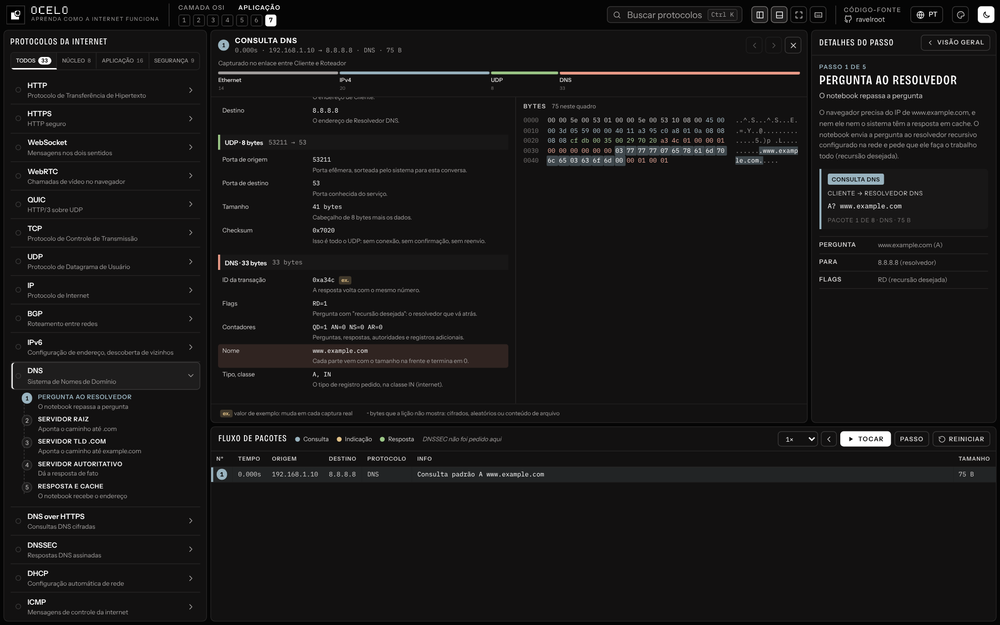
  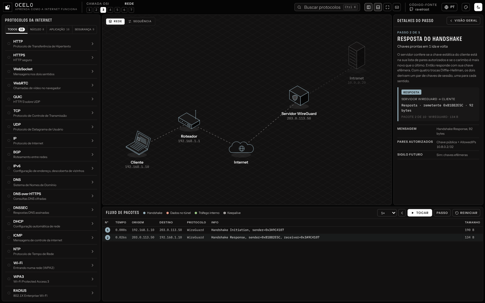
</p>

<p align="center">
  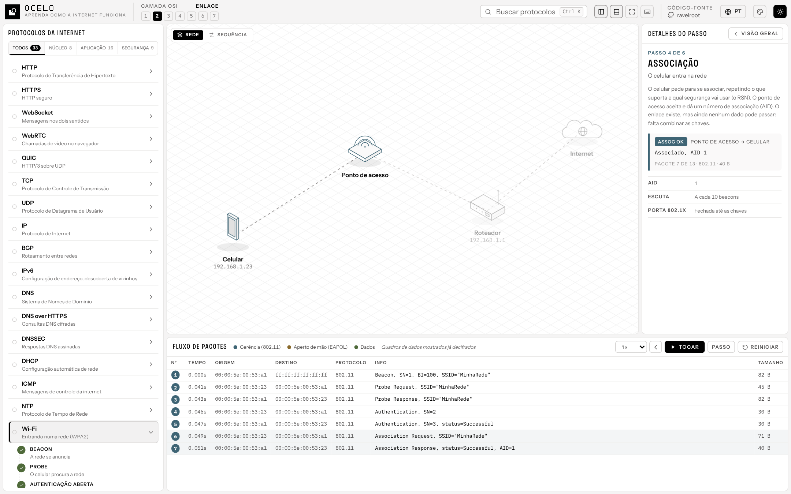
  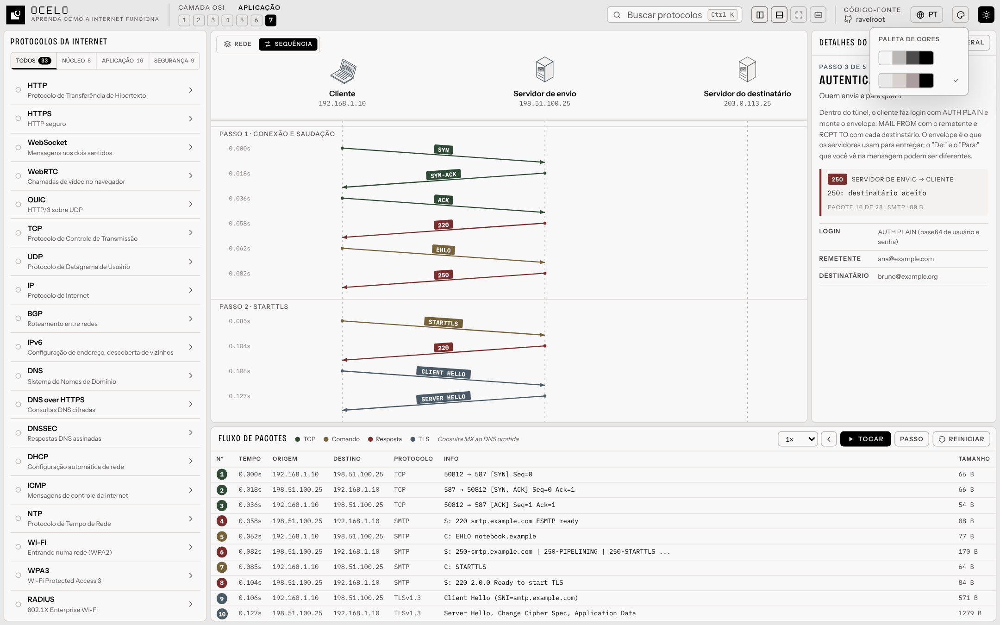
</p>

<p align="center">
  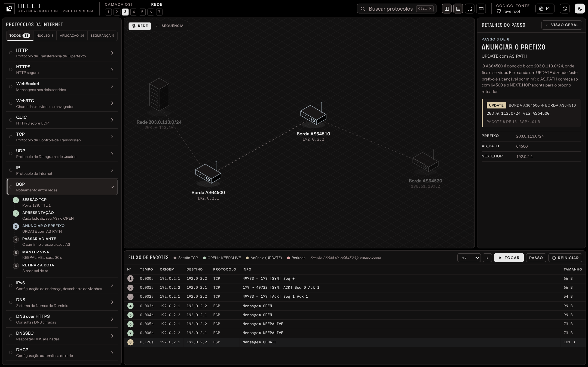
  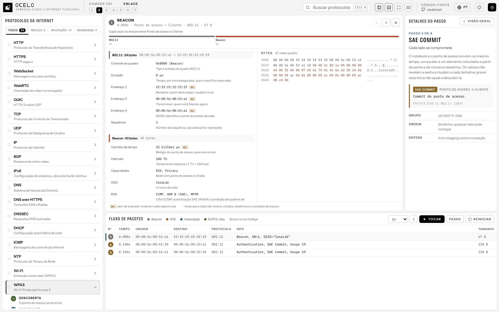
</p>

<p align="center">
  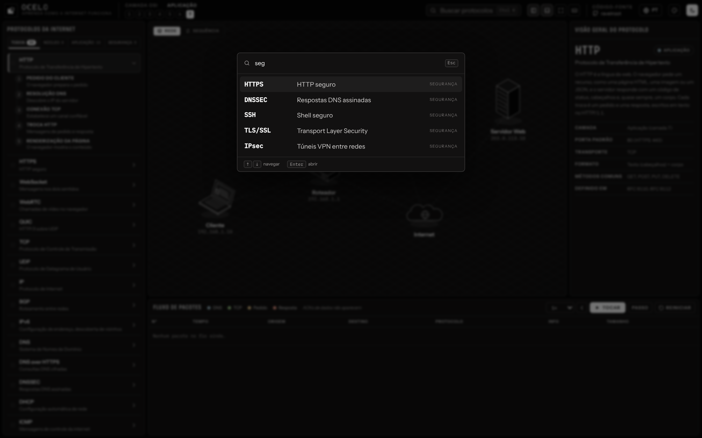
  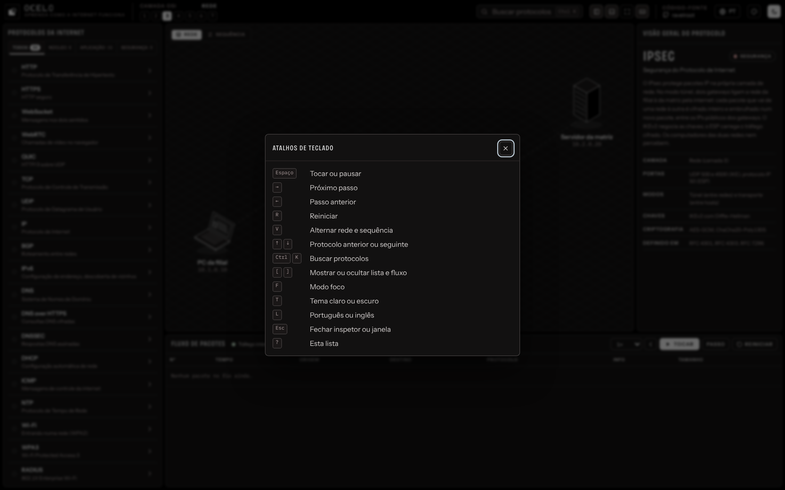
</p>

## Arquitetura

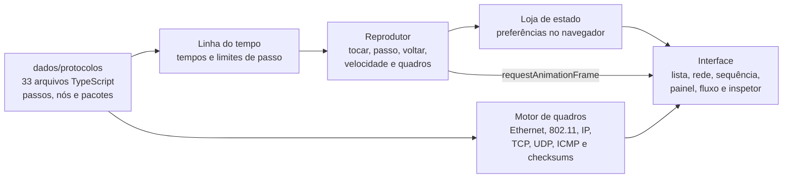

| Parte | Responsabilidade |
|---|---|
| `src/dados/tipos.ts` | Contrato de um protocolo: nós, ligações, faixas, legenda, passos, pacotes e a especificação de cada quadro |
| `src/dados/protocolos` | Os 33 protocolos, um arquivo cada, e o catálogo ordenado como na lista |
| `src/dados/base.ts`, `conversa.ts`, `fluxo-tcp.ts` | Ajudantes para textos bilíngues, nós padrão, aperto de mão TCP, conversas com seq/ack calculados e campos em hex ou texto |
| `src/rede/quadros.ts` | Monta os bytes de cada pacote, calcula os checksums e descreve cada campo com valor e explicação |
| `src/rede/rotas.ts` | Encontra o caminho entre dois nós pela topologia (busca em largura) |
| `src/app` | Estado da aplicação, linha do tempo, reprodutor e paletas |
| `src/ui` | Cabeçalho, lista, palco (rede, sequência e inspetor), painel, fluxo de pacotes, busca, atalhos, ícones e desenhos isométricos |
| `src/i18n/textos.ts` | Textos da interface em português e inglês |
| `src/css/estilo.css` | Tokens das duas paletas nos temas claro e escuro, layout, componentes, vistas e animações |
| `tests/unit` | Catálogo, quadros, checksums, rotas, linha do tempo e validação dos 33 protocolos |
| `tests/e2e` | Interface de ponta a ponta com Playwright |

### Como um pacote vira bytes

Cada pacote descreve só o que é dele: quem envia, quem recebe, as portas, as flags e os campos da aplicação. O motor de quadros completa o resto. Ele acha o caminho pela topologia para saber em qual enlace o quadro é capturado e quais endereços MAC usar, escreve o cabeçalho Ethernet ou 802.11, o IPv4 ou IPv6 com o checksum, o TCP, o UDP ou o ICMP com o pseudo-cabeçalho e, por fim, a carga com cada campo marcado. O resultado guarda o intervalo de bytes de cada campo, o que permite acender campo e bytes juntos no inspetor. Tudo é determinístico: o mesmo pacote gera sempre os mesmos bytes.

## Como rodar

### No navegador

O Ocelo está publicado em **https://ravelroot.github.io/Network-Protocol-Packet-Explorer/**. Não precisa instalar nada.

### Na sua máquina (Node.js 22+)

```bash
git clone https://github.com/ravelroot/Network-Protocol-Packet-Explorer.git
cd Network-Protocol-Packet-Explorer
npm ci
npm run dev                       # http://localhost:5173
```

Para gerar a versão de produção e conferir como ela fica publicada:

```bash
npm run build                     # gera a pasta dist/
npm run preview                   # http://localhost:4173
```

A pasta `dist/` é estática e funciona em qualquer servidor de arquivos ou CDN, inclusive em subpastas, porque os caminhos são relativos.

### Publicando no GitHub Pages

1. No repositório, abra **Settings** → **Pages**.
2. Em **Build and deployment**, escolha **GitHub Actions** como fonte.
3. Envie qualquer commit para a branch `main`. O workflow **GitHub Pages** roda os testes, gera o build e publica.
4. O endereço aparece na própria página de **Pages** e no resumo do workflow.

## Testes e qualidade

```bash
npm run typecheck                 # TypeScript em modo estrito
npm test                          # 107 testes unitários com Vitest
npx playwright install chromium
npm run test:e2e                  # interface de ponta a ponta com Playwright
```

Os testes unitários conferem o catálogo (33 protocolos, 8 de núcleo, 16 de aplicação e 9 de segurança), validam cada protocolo (textos nas duas línguas, nós, ligações, faixas, legenda e pacotes) e montam todos os 432 pacotes byte a byte, verificando os checksums IPv4, TCP e UDP, a continuidade das camadas e o determinismo. O CI roda a auditoria de dependências, o TypeScript, os testes, o build e o Playwright a cada push.

### Segurança

- **Política de segurança de conteúdo** no build: só scripts, estilos e fontes do próprio site, sem `eval`, sem objetos e sem formulários.
- **Nada de HTML montado a partir de texto:** a interface cria cada elemento pelo DOM, então nenhum conteúdo vira código.
- **Sem servidor, sem cookies e sem rastreadores:** as preferências ficam no `localStorage`, com leitura validada.
- **Dependências mínimas:** em produção são só as fontes. O Dependabot acompanha npm e GitHub Actions toda semana.

## Atalhos de teclado

| Tecla | Ação |
|---|---|
| `Espaço` | Tocar ou pausar |
| `→` / `←` | Próximo passo / passo anterior |
| `↓` / `↑` | Próximo protocolo / protocolo anterior |
| `R` | Reiniciar |
| `V` | Alternar entre rede e sequência |
| `Ctrl` + `K` ou `/` | Buscar protocolos |
| `[` / `]` | Mostrar ou ocultar a lista / o fluxo de pacotes |
| `F` | Modo foco |
| `T` | Tema claro ou escuro |
| `L` | Português ou inglês |
| `Esc` | Fechar o inspetor ou a janela aberta |
| `?` | Folha de atalhos |

## Os 33 protocolos

| Protocolo | Resumo | Categoria | Camada OSI | Passos | Pacotes | Definido em |
|---|---|---|---|---|---|---|
| [HTTP](https://ravelroot.github.io/Network-Protocol-Packet-Explorer/#/http) | Protocolo de Transferência de Hipertexto | Aplicação | 7 · Aplicação | 5 | 7 | RFC 9110, RFC 9112 |
| [HTTPS](https://ravelroot.github.io/Network-Protocol-Packet-Explorer/#/https) | HTTP seguro | Segurança | 7 · Aplicação | 5 | 8 | RFC 9110, RFC 8446 |
| [WebSocket](https://ravelroot.github.io/Network-Protocol-Packet-Explorer/#/websocket) | Mensagens nos dois sentidos | Aplicação | 7 · Aplicação | 6 | 9 | RFC 6455 |
| [WebRTC](https://ravelroot.github.io/Network-Protocol-Packet-Explorer/#/webrtc) | Chamadas de vídeo no navegador | Aplicação | 7 · Aplicação | 5 | 14 | RFC 8825–8835, W3C WebRTC |
| [QUIC](https://ravelroot.github.io/Network-Protocol-Packet-Explorer/#/quic) | HTTP/3 sobre UDP | Aplicação | 4 · Transporte | 5 | 8 | RFC 9000, RFC 9001, RFC 9114 |
| [TCP](https://ravelroot.github.io/Network-Protocol-Packet-Explorer/#/tcp) | Protocolo de Controle de Transmissão | Núcleo | 4 · Transporte | 6 | 14 | RFC 9293 |
| [UDP](https://ravelroot.github.io/Network-Protocol-Packet-Explorer/#/udp) | Protocolo de Datagrama de Usuário | Núcleo | 4 · Transporte | 4 | 9 | RFC 768 |
| [IP](https://ravelroot.github.io/Network-Protocol-Packet-Explorer/#/ip) | Protocolo de Internet | Núcleo | 3 · Rede | 5 | 10 | RFC 791 |
| [BGP](https://ravelroot.github.io/Network-Protocol-Packet-Explorer/#/bgp) | Roteamento entre redes | Núcleo | 3 · Rede | 6 | 13 | RFC 4271 |
| [IPv6](https://ravelroot.github.io/Network-Protocol-Packet-Explorer/#/ipv6) | Configuração de endereço, descoberta de vizinhos | Núcleo | 3 · Rede | 6 | 8 | RFC 8200, RFC 4861, RFC 4862 |
| [DNS](https://ravelroot.github.io/Network-Protocol-Packet-Explorer/#/dns) | Sistema de Nomes de Domínio | Núcleo | 7 · Aplicação | 5 | 8 | RFC 1034, RFC 1035 |
| [DNS over HTTPS](https://ravelroot.github.io/Network-Protocol-Packet-Explorer/#/doh) | Consultas DNS cifradas | Segurança | 7 · Aplicação | 6 | 8 | RFC 8484 |
| [DNSSEC](https://ravelroot.github.io/Network-Protocol-Packet-Explorer/#/dnssec) | Respostas DNS assinadas | Segurança | 7 · Aplicação | 6 | 10 | RFC 4033, 4034, 4035 |
| [DHCP](https://ravelroot.github.io/Network-Protocol-Packet-Explorer/#/dhcp) | Configuração automática de rede | Núcleo | 7 · Aplicação | 5 | 6 | RFC 2131, RFC 2132 |
| [ICMP](https://ravelroot.github.io/Network-Protocol-Packet-Explorer/#/icmp) | Mensagens de controle da internet | Núcleo | 3 · Rede | 5 | 8 | RFC 792 |
| [NTP](https://ravelroot.github.io/Network-Protocol-Packet-Explorer/#/ntp) | Protocolo de Tempo de Rede | Aplicação | 7 · Aplicação | 5 | 6 | RFC 5905 |
| [Wi-Fi](https://ravelroot.github.io/Network-Protocol-Packet-Explorer/#/wifi) | Entrando numa rede (WPA2) | Aplicação | 2 · Enlace | 6 | 13 | IEEE 802.11-2020 (inclui o 802.11i) |
| [WPA3](https://ravelroot.github.io/Network-Protocol-Packet-Explorer/#/wpa3) | Wi-Fi Protected Access 3 | Segurança | 2 · Enlace | 6 | 11 | IEEE 802.11-2020, Wi-Fi Alliance (2018) |
| [RADIUS](https://ravelroot.github.io/Network-Protocol-Packet-Explorer/#/radius) | 802.1X Enterprise Wi-Fi | Segurança | 7 · Aplicação | 5 | 16 | RFC 2865, RFC 3579, IEEE 802.1X |
| [Captive Portal](https://ravelroot.github.io/Network-Protocol-Packet-Explorer/#/captive) | Logins de Wi-Fi de hotel e café | Aplicação | 7 · Aplicação | 5 | 17 | RFC 8908, RFC 8910, RFC 8952 |
| [SMTP](https://ravelroot.github.io/Network-Protocol-Packet-Explorer/#/smtp) | Simple Mail Transfer Protocol | Aplicação | 7 · Aplicação | 5 | 28 | RFC 5321, RFC 6409, RFC 3207 |
| [POP3](https://ravelroot.github.io/Network-Protocol-Packet-Explorer/#/pop3) | Post Office Protocol v3 | Aplicação | 7 · Aplicação | 5 | 20 | RFC 1939, RFC 2595 |
| [IMAP](https://ravelroot.github.io/Network-Protocol-Packet-Explorer/#/imap) | Internet Message Access | Aplicação | 7 · Aplicação | 6 | 19 | RFC 9051 (IMAP4rev2), RFC 2177 |
| [FTP](https://ravelroot.github.io/Network-Protocol-Packet-Explorer/#/ftp) | File Transfer Protocol | Aplicação | 7 · Aplicação | 6 | 23 | RFC 959, RFC 2428 |
| [SMB](https://ravelroot.github.io/Network-Protocol-Packet-Explorer/#/smb) | Compartilhamento de arquivos do Windows | Aplicação | 7 · Aplicação | 6 | 17 | MS-SMB2 (Microsoft) |
| [SSH](https://ravelroot.github.io/Network-Protocol-Packet-Explorer/#/ssh) | Shell seguro | Segurança | 7 · Aplicação | 6 | 20 | RFC 4251–4254, RFC 8731 |
| [TLS/SSL](https://ravelroot.github.io/Network-Protocol-Packet-Explorer/#/tls) | Transport Layer Security | Segurança | 6 · Apresentação | 6 | 14 | RFC 8446 (TLS 1.3) |
| [HTTP Proxy](https://ravelroot.github.io/Network-Protocol-Packet-Explorer/#/proxy) | Proxy de saída e CONNECT | Aplicação | 7 · Aplicação | 5 | 18 | RFC 9110, RFC 9112 |
| [SOCKS5](https://ravelroot.github.io/Network-Protocol-Packet-Explorer/#/socks5) | Proxy Socket Secure | Aplicação | 5 · Sessão | 5 | 16 | RFC 1928, RFC 1929 |
| [Reverse Proxy](https://ravelroot.github.io/Network-Protocol-Packet-Explorer/#/reverseproxy) | Terminação de TLS | Aplicação | 7 · Aplicação | 5 | 20 | RFC 9110 (intermediários), RFC 7239 |
| [WireGuard](https://ravelroot.github.io/Network-Protocol-Packet-Explorer/#/wireguard) | Uma VPN moderna | Segurança | 3 · Rede | 5 | 10 | Whitepaper WireGuard (NDSS 2017); Linux 5.6+ |
| [IPsec](https://ravelroot.github.io/Network-Protocol-Packet-Explorer/#/ipsec) | Túneis VPN entre redes | Segurança | 3 · Rede | 5 | 10 | RFC 4301, RFC 4303, RFC 7296 |
| [Modbus](https://ravelroot.github.io/Network-Protocol-Packet-Explorer/#/modbus) | Controle industrial (OT) | Aplicação | 7 · Aplicação | 5 | 14 | Modbus Application Protocol v1.1b3 |

## Adicionando um protocolo

1. Crie `src/dados/protocolos/<id>.ts` exportando um objeto `Protocolo` (veja `http.ts` como modelo).
2. Defina os nós com posição no palco (`x` e `y` de 6 a 94 e de 12 a 88), as ligações e as faixas da vista de sequência.
3. Escreva os passos com título, resumo, descrição e fatos, em português e inglês, e os pacotes de cada passo com o `quadro` (portas, flags e campos da carga).
4. Inclua o `id` em `ORDEM`, no arquivo `src/dados/protocolos/index.ts`.
5. Rode `npm test`: a validação aponta qualquer nó, faixa, legenda ou quadro inconsistente.

## Estrutura de pastas

```
src/
  app/                      estado, reprodutor, linha do tempo e paletas
  css/                      estilo.css com tokens, layout, componentes e animações
  dados/
    protocolos/             os 33 protocolos e o catálogo
    tipos.ts                contrato de dados
  i18n/                     textos da interface em português e inglês
  rede/                     motor de quadros e rotas
  ui/                       componentes da interface e desenhos isométricos
  main.ts                   ponto de entrada e atalhos de teclado
public/                     ícone
tests/
  unit/                     Vitest
  e2e/                      Playwright
docs/                       manuais em PDF e imagens do README
.github/                    CI, GitHub Pages e Dependabot
VERSION                     versão do projeto
```

### Componentes de terceiros

O Ocelo depende de componentes com licenças próprias, que continuam valendo para cada um deles:

| Componente | Uso no projeto | Licença |
|---|---|---|
| [Vite](https://vite.dev/) | Servidor de desenvolvimento e build | MIT |
| [TypeScript](https://www.typescriptlang.org/) | Linguagem e verificação de tipos | Apache-2.0 |
| [Vitest](https://vitest.dev/) | Testes unitários | MIT |
| [Playwright](https://playwright.dev/) | Testes de ponta a ponta | Apache-2.0 |
| [Bricolage Grotesque](https://fonts.google.com/specimen/Bricolage+Grotesque), [Instrument Sans](https://fonts.google.com/specimen/Instrument+Sans) e [IBM Plex Mono](https://www.ibm.com/plex/) via [Fontsource](https://fontsource.org/) | Tipografia | OFL-1.1 |

Os endereços IP usados nos exemplos são de faixas reservadas para documentação (RFC 5737 e RFC 3849) ou de serviços públicos conhecidos, e os domínios seguem a RFC 2606. Os nomes de produtos e marcas citados pertencem aos seus donos.

## Licença

Copyright (©) 2026 Erik Pimenta

Este projeto é distribuído sob a licença [MIT](LICENSE). Você pode usar, copiar, modificar e redistribuir o código, inclusive para fins comerciais, desde que mantenha o aviso de copyright e o texto da licença.
